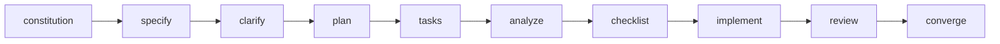

# CLAUDE.md — working brief for this repo

This is the onboarding document for any Claude session opened inside
`claude-speckit-phx-elixir`. Read it first. It tells you what the project is, how it is
built, how to extend it safely, and where the deep design lives.

This repo is a Claude Code **plugin** (a distributable bundle of commands, agents, skills,
and hooks) — it is NOT an application. There is no `mix.exs` here and nothing to compile.
You are editing the plugin itself, not using it.

## What this is

`claude-speckit-phx-elixir` is a single self-contained Claude Code plugin that delivers
**spec-driven development for Elixir/Phoenix**. It IS the full spec-kit flow
(constitution -> specify -> clarify -> plan -> tasks -> analyze -> checklist -> implement,
plus all git commands, tasks-to-issues, agent-context) carrying **all** the essential
Elixir/Phoenix engineering intelligence fused inside it.

**The thesis:** specifications do not serve code — code serves specifications. Spec Kit
gives the disciplined spec-driven spine; the Elixir/Phoenix plugin gives the domain
expertise (Ecto, LiveView, Oban, Ash, OTP) and the Iron Laws that make Phoenix code
correct. Neither half alone is enough: a generic spec flow does not know that `mount`
runs twice or that money must never be a float, and a pile of Phoenix advice has no
disciplined lifecycle to attach to. This plugin fuses them into one flow where every
planning and review step is Phoenix-aware and every Iron Law is enforced mechanically.

It is a **derivative work** fusing two MIT-licensed upstreams — `github/spec-kit` and
`oliver-kriska/claude-elixir-phoenix`. Attribution is mandatory: see `NOTICE.md` and the
README credits. Never strip or dilute that.

## Architecture — three fused layers

| Layer | Source | What it provides |
|---|---|---|
| **Spec-kit spine** | `github/spec-kit` | The lifecycle commands, artifact templates (spec/plan/tasks/checklist/constitution), and the bash automation under `scripts/`. Works in ANY repo. |
| **Absorbed Phoenix intelligence** | `claude-elixir-phoenix` | 26 specialist agents, the domain skills (Ecto/LiveView/Oban/Ash/OTP/security/testing) with all references, and the enforcement hooks. Self-gates on `mix.exs` — activates only in Elixir projects (D9). |
| **Fused constitution** | Both upstreams, synthesized | `memory/constitution.md` — the single canonical corpus: 7 core principles, 53 Iron Laws (+9b), workflow laws, a complexity router, and conditional stack annexes. |

Everything valuable that fits the linear flow was **absorbed** into a spine command;
everything valuable that does not fit became its own `/spx:*` command; nothing essential
was dropped silently. The full absorption map (every upstream asset, one decision, no
silent drops) is section 4 of `BLUEPRINT.md`.



Pre-work (`brainstorm`, `assess`) feeds `specify`; `full` drives the whole chain
autonomously; capability commands (`review`, `investigate`, `deps-audit`, etc.) attach at
any point.

## Directory map

```text
.claude-plugin/plugin.json   # manifest: name, version 0.1.0, description, keywords
settings.json                # {"effort":"medium","showTurnDuration":true}
memory/
  constitution.md            # THE canonical constitution (single source of truth)
  derivations.md             # the single-source rule + the 4 derived-copy list (D3)
templates/                   # spec/plan/tasks/checklist/constitution + md-blocks + wiring (10)
scripts/                     # bash spine automation; every script self-gates + emits --json (9)
  git/                       # git-common, auto-commit, initialize-repo
commands/                    # 21 lifecycle + flow commands (name: spx:<cmd>)
agents/                      # 26 specialist subagents (flat *.md)
skills/                      # 48 skill dirs: domain/infra (auto-load) + workflow commands
hooks/
  hooks.json                 # 10 events wired to the scripts below
  scripts/                   # 22 enforcement/detection scripts
  tests/                     # block-dangerous-ops regression harness (shipped)
BLUEPRINT.md                 # the full design (decisions, absorption map, constitution text)
docs/build/*-report.md       # per-group build reports (what was actually built)
NOTICE.md  LICENSE           # MIT attribution to both upstreams
```

The `.sources/` tree holds the two upstream repos plus the live `.specify` snapshots used
as fusion sources. It is reference material for building the plugin — it is NOT shipped.

**Command surface:** all commands are namespaced `/spx:*` (D1). The 21 spec-kit-derived
lifecycle commands live in `commands/`; the ~33 capability commands live as invocable
skills in `skills/` (skills can ship `references/`, `scripts/`, `priv/`; command files
cannot). Both carry `name: spx:<cmd>` frontmatter so they surface as one uniform set.

## Runtime artifact layout (what the plugin writes in a user's project)

Do not confuse this with the plugin's own tree. When the plugin runs in a Phoenix project
it writes to `specs/<NNN-slug>/` (spec.md, plan.md, tasks.md, research/, reviews/,
scratchpad.md, progress.md, …) plus cross-feature state under `.specify/` (feature.json,
memory/constitution.md, bugs/, assessments/) and `.claude/` (solutions/, research/,
deps-audit/). This is D2. Any hook/agent/skill that once hardcoded `.claude/plans/{slug}/`
was re-pointed to `specs/<feature>/`.

## How to develop and extend the plugin

General rule: study the matching build report in `docs/build/` and the relevant
`BLUEPRINT.md` section before touching a subsystem, then keep new work consistent with
what is already there. Contributor coding conventions (shell style, frontmatter fields,
quoting) live in `AGENTS.md` — read it before editing.

- **Add a command** — create `commands/<name>.md` with `name: spx:<name>`, a
  `description`, an `argument-hint`, and (for spine commands) `handoffs` to the next
  phase. Inline any Pre/Post hook steps from `templates/extensions.yml` as ordered steps.
  Invoke scripts via `${CLAUDE_PLUGIN_ROOT}/scripts/`.
- **Add a capability as a skill** — create `skills/<name>/SKILL.md`. Domain/infra skills
  use `paths:` globs and usually `user-invocable: false`; workflow-command skills carry
  `name: spx:<name>` and are invocable. Ship `references/`, `scripts/`, `priv/` alongside
  and reference them via `${CLAUDE_SKILL_DIR}`.
- **Add an agent** — create `agents/<name>.md`. Preserve the frontmatter contract:
  `model`/`effort` per the D12 economics (haiku for cheap workers, opus only for
  parallel-reviewer / security-analyzer / full-driver, sonnet elsewhere),
  `permissionMode: bypassPermissions`, `omitClaudeMd: true` and
  `disallowedTools: Edit, NotebookEdit` on read-only reviewers. Every `skills:` entry must
  resolve to a shipped skill; agent output goes to a file under the feature dir, never raw
  into chat; nesting depth stays <= 5.
- **Add a hook** — add the script to `hooks/scripts/`, wire it in `hooks/hooks.json` with
  the correct event/matcher/`if`/timeout, and honor that event's output contract (section
  6 of `BLUEPRINT.md`). Elixir-specific hooks MUST self-gate on `mix.exs` (D9). Keep
  `block-dangerous-ops.sh` fail-open (`|| exit 0`).

### The constitution single-source rule (critical — D3)

`memory/constitution.md` is the **one** canonical corpus. Four copies are DERIVED from it
and must never be edited by hand to change a rule:

| Derived copy | Mirrors |
|---|---|
| `hooks/scripts/inject-iron-laws.sh` | the laws as a bullet list injected into every subagent (their only channel) |
| `hooks/scripts/iron-law-verifier.sh` | the programmatically checkable laws (4, 10, 12, 14, 15, 21) |
| `templates/agents-md-block.md` | the P1-P3 review rubric (codex / AGENTS.md block) |
| `templates/claude-md-block.md` | the condensed marker block installed into a project's CLAUDE.md |

To change a rule: edit `constitution.md` only, regenerate all four copies, bump the
constitution semver, record a Sync Impact Report, and verify the copies agree before
committing. This regeneration is a mandatory step of `/spx:constitution` and is spelled
out in `memory/derivations.md`.

### Run the checks

`make ci` is the gate (lint + validate + hook tests). It runs `markdownlint` against
`.markdownlint.json`, `yamllint`, `jq` over every JSON (hooks.json must parse), the
`hooks/tests/` regression harness, and `claude plugin validate .`. Also run the
consistency sweep (BLUEPRINT task 52): `/phx:`, `/speckit`, `.claude/plans/`, any source-project names,
and leftover render placeholders (`__SPECKIT_COMMAND_*__`, `{SCRIPT}`, `__AGENT__`) must
return zero hits across commands/skills/agents/hooks; every `skills:` target and every
`${CLAUDE_PLUGIN_ROOT}`/`${CLAUDE_SKILL_DIR}` path must resolve. (If `make ci` is not yet
present, these checks are still the definition of green.)

## Release-based workflow

Semver from `v0.1.0`; a keep-a-changelog `CHANGELOG.md`. Ship by bumping
`.claude-plugin/plugin.json` `version`, finalizing the CHANGELOG entry, gating on
`make ci`, committing, tagging `vX.Y.Z`, and cutting a GitHub release. A constitution
amendment carries its own semver (MAJOR removals/redefinitions, MINOR new principles,
PATCH wording) independent of the plugin version. Never add Claude co-authorship
attribution to commits or releases.

## Where the deep design lives

- **`BLUEPRINT.md`** — the authority. Global decisions D1-D13, the final directory tree,
  the plugin manifest, the full 55-command catalog with per-command agent/skill/hook
  wiring, the complete absorption map (section 4), the full constitution text (section 5),
  the hooks contract (section 6), and the ordered build task list (section 7).
- **`docs/build/*-report.md`** — what each build group actually produced, including
  namespace-remap verification greps. Start here to learn the real state of a subsystem.
- **`memory/constitution.md` + `memory/derivations.md`** — the rules and the regeneration
  procedure.
- **`.sources/`** — the two upstream repos; consult when porting or verifying faithfulness.

## Roadmap

| Milestone | Status |
|---|---|
| Functional plugin (Groups A-G): manifest, constitution, scripts, templates, 21 commands, 26 agents, 48 skills, 22 hooks | Shipped (v0.1.0) |
| Public-repo layer (Group H): README, CHANGELOG, Makefile, CI, this knowledge base | In progress |
| Full adversarial + smoke test in a scratch Phoenix app (BLUEPRINT task 53) | Pending |
| First public release on GitHub (`carlosgr092/claude-speckit-phx-elixir`) | Pending |

Do not announce the plugin as public-ready until the adversarial/smoke test passes.

## Key decisions (D1-D13 at a glance)

- **D1 Namespace** — every command is `/spx:*` with `name: spx:<cmd>`. Lifecycle commands
  in `commands/`; capability commands as invocable skills in `skills/`.
- **D2 Artifact layout** — feature workspace is `specs/<NNN-slug>/`; cross-feature state in
  `.specify/` and `.claude/`; `.specify/feature.json` is the single feature-state channel.
- **D3 Constitution single-sourcing** — `memory/constitution.md` is canonical; four derived
  copies are regenerated on every amendment.
- **D4 full vs flow** — one `/spx:full` autonomous driver over the whole chain (with
  optional gates); `full-driver` agent is its engine, never a parallel mini-flow.
- **D5 brainstorm vs specify** — `/spx:brainstorm` stays separate and produces
  `interview.md`, a first-class input to `/spx:specify`; its coverage scoring also feeds
  `/spx:clarify`.
- **D6 lean** — `--lean` is a flag on constitution/specify/plan/tasks/implement, not a
  separate command.
- **D7 investigate vs bug** — both exist: `/spx:investigate` = fast root-cause;
  `/spx:bug` = artifact-based assess->fix->test loop that delegates assess to investigate.
- **D8 spec.md is the review contract** — `/spx:review` and requirements-verifier default
  their requirements source to the feature's `spec.md`.
- **D9 Elixir gating** — the spine works in any repo; every Elixir hook/behavior self-gates
  on `mix.exs` (issue #55).
- **D10 checklist doctrine** — `/spx:checklist` keeps the "unit tests for English"
  requirements-quality doctrine; the 9-item Elixir verification list moved into implement's
  Verification Gate.
- **D11 attribution** — `NOTICE.md` carries MIT notices for both upstreams, covering all
  copied content.
- **D12 model economics** — haiku for cheap workers, opus only for
  parallel-reviewer/security-analyzer/full-driver, sonnet elsewhere; nesting depth <= 5;
  `bypassPermissions` on agents; `omitClaudeMd` on read-only reviewers.
- **D13 quotes** — straight quotes `""` everywhere, never angle quotes `«»`. Also seeded in
  the constitution style section.
