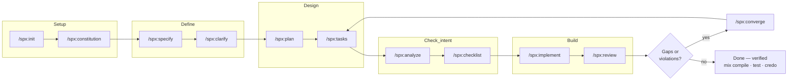

<div align="center">

<h1>claude-speckit-phx-elixir</h1>

<h3><em>Spec-driven development that speaks Elixir.</em></h3>

<p>The disciplined spec-kit flow — constitution, specify, clarify, plan, tasks, analyze, checklist, implement — with deep Phoenix, Ecto, LiveView, Oban, Ash, and OTP knowledge fused into every phase. One Claude Code plugin. <code>/spx:*</code> commands.</p>

<p>
  
  
  
  
  
  
</p>

</div>

---

## Table of Contents

- [Why this exists](#why-this-exists)
- [What it is](#what-it-is)
- [The flow](#the-flow)
- [Install](#install)
- [Quickstart](#quickstart)
- [Command reference](#command-reference)
  - [The spine (10)](#the-spine-10)
  - [Git commands (5)](#git-commands-5)
  - [Flow extensions (6)](#flow-extensions-6)
  - [Capability commands (34)](#capability-commands-34)
- [The Iron Laws](#the-iron-laws)
- [Artifact layout](#artifact-layout)
- [How it works](#how-it-works)
- [Attribution](#attribution)
- [Contributing](#contributing)
- [License](#license)

## Why this exists

Two excellent tools each solve half the problem.

**[spec-kit](https://github.com/github/spec-kit)** gives you the disciplined *how* — a spec-driven process where specifications, not code, are the source of truth. Constitution to specify to clarify to plan to tasks to analyze to implement. It is rigorous, repeatable, and deliberately **stack-agnostic**: it never assumes Elixir, Rails, or anything else.

**[claude-elixir-phoenix](https://github.com/oliver-kriska/claude-elixir-phoenix)** by Oliver Kriska holds deep Elixir/Phoenix expertise — Ecto, LiveView, Oban, OTP, Ash, and 53 hard-won "Iron Laws" that catch the mistakes that only surface in production. But it imposes **no formal process**: it is a library of knowledge, activated by intent, not a pipeline.

Neither alone is enough. A stack-agnostic process cannot tell you that `mount/3` runs twice, that money must never be a float, or that an Oban worker must be idempotent. A knowledge base without a process cannot stop you from coding before the spec is clear.

**This project fuses them.** It takes spec-kit's spine and makes every phase Elixir-aware: `specify` asks the Phoenix-shaped questions, `plan` delegates to Ecto and LiveView specialists, `tasks` encodes migration-safety ordering, `implement` gates on `mix compile --warnings-as-errors` and enforces the Iron Laws mechanically through hooks. You get spec-driven development where best practices are baked in from spec to verified code — so you ship features more precisely, more correctly, and with the footguns removed before they fire.

It is a **derivative work** that fuses and adapts both upstreams (both MIT). See [Attribution](#attribution).

## What it is

A single Claude Code plugin exposing **55 `/spx:*` slash commands**, **26 specialist subagents**, **48 skills** (domain knowledge + workflow procedures), and **23 enforcement hooks**, all governed by **one merged constitution** of 53 Iron Laws across 9 Articles. The spec-kit spine runs in *any* repository; the Elixir intelligence self-activates only when a `mix.exs` is present, so the plugin is safe to install everywhere and never gets in the way on non-Elixir projects.

## The flow

Every phase below is Elixir-aware: it consults the relevant specialists, loads the matching skills by file pattern, and enforces the constitution.



Prefer to drive the whole chain autonomously? `/spx:full` runs it end to end with optional human gates and cycle caps.

## Install

The plugin is distributed through its own marketplace. In Claude Code:

```text
/plugin marketplace add carlosgr092/claude-speckit-phx-elixir
/plugin install claude-speckit-phx-elixir
```

Prefer a local checkout (for hacking on the plugin, or air-gapped use):

```bash
git clone https://github.com/carlosgr092/claude-speckit-phx-elixir.git
```

Then point Claude Code at the directory:

```text
/plugin marketplace add ./claude-speckit-phx-elixir
/plugin install claude-speckit-phx-elixir
```

Restart Claude Code so the hooks and commands load. Verify with `/spx:doctor`.

## Quickstart

Run these inside your project. Each phase stops and hands you the next step — nothing auto-transitions (that is Workflow Law W1).

```text
# 1. Bootstrap the .specify/ workspace, detect your stack, install the CLAUDE.md block
/spx:init

# 2. Ratify your engineering constitution (seeded with the 53 Iron Laws)
/spx:constitution

# 3. Describe WHAT you want to build and WHY (no tech stack here)
/spx:specify Add team invitations: an owner invites a teammate by email, the invite
expires after 7 days, and accepting it creates a scoped membership.

# 4. Answer up to 5 targeted questions to remove ambiguity
/spx:clarify

# 5. Turn the spec into a technical plan — Ecto schema, context, LiveView, scoping
/spx:plan

# 6. Break the plan into dependency-ordered, migration-safe tasks
/spx:tasks

# 7. Read-only cross-artifact consistency check (blocks on CRITICAL)
/spx:analyze

# 8. Generate requirements-quality checklists ("unit tests for English")
/spx:checklist

# 9. Execute tasks phase by phase, verifying after every task
/spx:implement
```

New to the plugin? Run `/spx:intro` for a guided walkthrough, or `/spx:help` when you are unsure which command fits.

## Command reference

55 commands, grouped by role. All share the `/spx:` namespace.

### The spine (10)

The spec-kit lifecycle, rewired so absorbed Elixir intelligence fires inside each phase.

| Command | Purpose |
|---|---|
| `/spx:constitution` | Create or amend the project constitution from the shipped 53-law default; detect stack; bump semver; regenerate the four derived enforcement copies. |
| `/spx:specify` | Turn a natural-language feature into `specs/<NNN-slug>/spec.md`; branch via git-feature; at most 3 `[NEEDS CLARIFICATION]` markers; self-validating requirements checklist. |
| `/spx:clarify` | Ask up to 5 targeted questions, one at a time, each with a recommended option; Phoenix-shaped probes (tenancy, LiveView vs static, jobs, real-time); integrate answers back into the spec. |
| `/spx:plan` | Produce plan.md, research.md, data-model.md, contracts/, quickstart.md; Constitution Check gates; an Elixir/Phoenix Design section mapping each decision to a principle and delegating to design specialists. |
| `/spx:tasks` | Emit a dependency-ordered `tasks.md` by user story; declare preloads per collection task, an idempotency test per Oban task, migration-safety sequencing, and a final Verification Gate task. |
| `/spx:analyze` | Strictly read-only cross-artifact consistency across spec/plan/tasks; constitution conflicts are CRITICAL; advisory specialist pass; blocks `implement` on CRITICAL. |
| `/spx:checklist` | Generate requirements-quality checklists ("unit tests for English") with Phoenix domain presets; append-only, with traceability. |
| `/spx:implement` | Execute tasks phase by phase; per-task `mix compile --warnings-as-errors`; per-phase affected tests and credo; skill auto-load per edited file; Verification Gate at each phase; parallel review before DONE. |
| `/spx:tasks-to-issues` | Create one GitHub issue per task, deduplicated by `T###` title match, via the `gh` CLI. |
| `/spx:agent-context` | Maintain the marker-managed `SPECKIT` block in CLAUDE.md and the codex review block in AGENTS.md; never touches content outside the markers. |

### Git commands (5)

Auto-wired into the spine (git-init before constitution, git-feature before specify) and available standalone.

| Command | Purpose |
|---|---|
| `/spx:git-init` | `git init` plus an initial commit; skips if already a repo. |
| `/spx:git-feature` | Create a feature branch with sequential or timestamp numbering and a configurable template. |
| `/spx:git-commit` | Optional per-phase auto-commit, gated by config and disabled by default. |
| `/spx:git-validate` | Confirm the branch matches the expected feature-branch form and cross-check `specs/`. |
| `/spx:git-remote` | Detect the GitHub remote for issues and PR workflows; returns empty, never errors. |

### Flow extensions (6)

New commands that live in spec-kit territory but extend the linear flow.

| Command | Purpose |
|---|---|
| `/spx:converge` | Post-implement gap assessment; append-only `Convergence` phase in tasks.md; constitution violations first as CRITICAL; Elixir-aware checks. |
| `/spx:full` | Autonomous driver over the whole chain with a state machine, cycle caps, and optional human gates (`--gates`) or full auto (`--auto`). |
| `/spx:assess` | Pre-specify idea pipeline (intake, research, define, shape, decide) with a go / needs-clarification / kill gate. |
| `/spx:bug` | Artifact-based bugfix loop (assess, fix, test); the only flow where a phase edits source. |
| `/spx:init` | Idempotent project bootstrap: create `.specify/`, detect stack, install marker blocks, seed the constitution only if missing. |
| `/spx:doctor` | Read-only health check of plugin and project state, hook wiring, and tool availability; supports `--json`. |

### Capability commands (34)

Elixir/Phoenix intelligence that does not fit the linear flow. Each is an invocable skill.

| Command | Purpose |
|---|---|
| `/spx:review` | Read-only parallel review (Elixir, Iron Laws, security, tests, requirements) with persistent dedupe and verdicts. |
| `/spx:triage` | Interactively approve, skip, or prioritize review findings into a fix queue. |
| `/spx:challenge` | Adversarial "grill me" review before you approve a change. |
| `/spx:quick` | Escape hatch for single-file changes under 50 lines — no ceremony, Iron Laws still enforced. |
| `/spx:verify` | Standalone compile / format / test verification loop. |
| `/spx:investigate` | Root-cause debugging (solutions-first, Tidewave capture, `--parallel` four-track). |
| `/spx:trace` | Build call trees via `mix xref callers`. |
| `/spx:n1-check` | Detect N+1 queries: `Repo` calls in loops and missing preloads. |
| `/spx:boundaries` | Score context-boundary health 0-100, xref-verified. |
| `/spx:assigns-audit` | Read-only LiveView assigns memory audit (streams, temporary_assigns, unused assigns). |
| `/spx:narrow-bare-rescue` | Narrow `rescue _ ->` using the verified exception taxonomy. |
| `/spx:perf` | Performance analysis across Ecto, LiveView, and OTP on an impact-effort grid. |
| `/spx:techdebt` | Debt detection via credo plus duplicate-pattern greps; three-strikes rule. |
| `/spx:audit` | Project-wide health audit with parallel auditors and an A-F grade. |
| `/spx:deps-audit` | Non-mutating Hex supply-chain audit (rules catalogue, CVEs, LLM triage, SARIF/CI). |
| `/spx:deps-update` | Mutating dependency updates with changelog snapshots and one-major-per-PR discipline. |
| `/spx:deps-vet` | Manage the `hex_vet.exs` audit ledger. |
| `/spx:freeze` | Scoped edit lock backed by a sentinel and a PreToolUse gate. |
| `/spx:permissions` | Mine the session transcript for a safe `settings.json` allowlist. |
| `/spx:mix-compression` | Install rtk filters that compress noisy mix output. |
| `/spx:research` | Web research with query decomposition and parallel workers; `--library` eval mode. |
| `/spx:recall` | Recall prior work from solutions docs, git history, and transcripts. |
| `/spx:compound` | Capture solved problems into searchable solution docs. |
| `/spx:learn` | Capture lessons and drive constitution amendments; never edits plugin cache. |
| `/spx:document` | Generate `@moduledoc`/`@doc`, README, and ADR content. |
| `/spx:brief` | Interactive walkthrough of a feature's WHY (pre-work) or what was built (post-work). |
| `/spx:brainstorm` | Adaptive requirements interview feeding `/spx:specify`. |
| `/spx:help` | Recommend the right command for the task at hand. |
| `/spx:intro` | Six-section guided tour of the plugin. |
| `/spx:pr-review` | Resolve PR review threads: fix, reply, resolve, with mandatory approval. |
| `/spx:watch-pr` | Background PR watcher that wakes only on real CI or review events. |
| `/spx:codex-loop` | Critic-refiner loop against the Codex CLI. |
| `/spx:deploy` | Deployment reference and validation (Docker, Fly, K8s); paths-triggered and invocable. |
| `/spx:ecto-constraint-debug` | Constraint-error debugging procedure; error-triggered and invocable. |

## The Iron Laws

The constitution is the heart of the plugin: **9 Articles** codifying **53 Iron Laws**, 7 Core Principles, and the workflow and governance rules. When code would violate a law, the STOP protocol fires: the assistant names the law, shows what was written, shows the correct pattern, and asks before applying a fix. Six laws are also checked programmatically by a PostToolUse hook, and the full corpus is injected into every subagent.

**Core Principles (Article I).** Scope-first authorization (no IDOR); thin web, fat context (zero `Repo.` calls in the web layer); deterministic core (injectable Clock, effects behind adapters); no N+1; idempotent jobs; the Verification Gate; and spec authority (analyze is read-only, converge is append-only, principles are never diluted).

The 53 laws (Article II), by domain:

| Domain | Laws | Representative rules |
|---|---|---|
| **LiveView** | 1, 2, 3, 18, 21, 24, 28, 29, 30 | No unconditional DB queries in `mount` (it runs twice); streams for lists over ~100 items; check `connected?/1` before PubSub; extract values before `assign_async` closures; `handle_params/3` owns URL-derived state; never pass the socket into context functions. |
| **Ecto** | 4, 5, 6, 15, 17, 19, 31, 32, 33, 34 | Never `:float` for money; always pin `^` user input; separate queries for `has_many` preloads; no implicit cross joins; `cast/4` for external input only; constraints beat validations for race-prone data; owning-column-first migration order. |
| **Oban** | 7, 8, 9, 9b, 35, 36 | Jobs must be idempotent; string keys in args; store IDs, never structs; handle every `perform` return shape; never limit snoozes via `attempt`. |
| **Security** | 10, 11, 12, 37, 38 | No `String.to_atom/1` on user input; authorize in every `handle_event`; never `raw/1` untrusted content; validate at the boundary; secrets via `runtime.exs` only. |
| **OTP / Elixir** | 13, 14, 16, 20, 23, 25, 27 | No process without a runtime reason; supervise all long-lived processes; wrap third-party APIs behind facades; capture locale before spawning; never a bare `rescue _ ->`. |
| **Contexts & boundaries** | 39, 40 | No side effects in schema modules; never refactor boundaries without `mix xref` evidence. |
| **Testing** | 41-48 | `async: true` by default; SQL Sandbox isolation; mock only owned boundaries; `build/2` over `insert/2`; no `Process.sleep`; `verify_on_exit!` in setup. |
| **Deploy / Ops** | 49-53 | Runtime config for env-dependent values; graceful shutdown drain window; light health endpoints; SSL `verify_peer`; never CPU-limit BEAM containers. |
| **Style & Verification** | 22, 26 | Verify before claiming done (run `mix compile && mix test`, show the result); comments hold durable facts, not commit messages; straight quotes only. |

The remaining Articles govern the process: **III** Workflow Laws (23 rules — no auto-transitions, verify after every task, read-only reviews, test-first), **IV** the Complexity Router (score a request, route to quick / specify / full), **V** conditional stack annexes (Oban, Oban Pro, Ash, Tidewave), **VI** skill and agent execution enforcement, **VII** the four enforcement channels kept in sync, and **VIII** governance and amendment. **IX** is a reserved slot for the project's own principles, empty in the shipped default and filled by `/spx:constitution`.

## Artifact layout

Each feature gets a workspace under `specs/`, extending spec-kit's layout with the Phoenix additions:

```text
specs/<NNN-slug>/
├── spec.md            # WHAT and WHY (the review contract)
├── plan.md            # HOW — architecture, Elixir/Phoenix design
├── tasks.md           # dependency-ordered, migration-safe tasks (checkboxes ARE the state)
├── research.md        # or research/<agent>-report.md for fan-out
├── data-model.md      # Ecto schemas and relationships
├── contracts/         # API and context contracts
├── quickstart.md      # how to exercise the feature
├── checklists/        # requirements-quality checklists (CHK###)
├── reviews/           # review findings (read-only agents write here)
├── summaries/         # compressed specialist output
├── scratchpad.md      # dead-ends and handoffs
└── progress.md        # /spx:full state machine
```

Cross-feature state lives under `.specify/` (constitution, templates, feature.json, assessments, bugs) and `.claude/` (solutions, research, deps-audit, audit). Feature state is tracked in `.specify/feature.json`, never in the branch name (Workflow Law W16).

## How it works

For the full architecture — how the spec-kit spine is wired, how 26 agents and 48 skills were absorbed, and how the constitution is single-sourced across four enforcement channels — see **[docs/ARCHITECTURE.md](docs/ARCHITECTURE.md)**.

## Attribution

`claude-speckit-phx-elixir` is a **derivative work** that fuses and adapts two MIT-licensed upstream projects. Full notices are in [NOTICE.md](NOTICE.md).

| Upstream | Author | What we adapted |
|---|---|---|
| [github/spec-kit](https://github.com/github/spec-kit) | GitHub, Inc. and contributors | The spec-driven flow, command and artifact templates, and the `scripts/` automation. |
| [oliver-kriska/claude-elixir-phoenix](https://github.com/oliver-kriska/claude-elixir-phoenix) | Oliver Kriska | The 26 specialist agents, the Elixir/Phoenix/Ecto/LiveView/Oban/Ash/OTP skills, the enforcement hooks, and the Iron Laws corpus. |

Both upstreams are MIT-licensed. This project is grateful to both — it exists only because their work is open.

## Contributing

Contributions are welcome. Please read [CONTRIBUTING.md](CONTRIBUTING.md) and the [Code of Conduct](CODE_OF_CONDUCT.md) first. Security issues should be reported privately — see [SECURITY.md](SECURITY.md). For questions and help, see [SUPPORT.md](SUPPORT.md).

## License

Released under the [MIT License](LICENSE). Copyright (c) 2026 carlosgr092. Portions derive from github/spec-kit and oliver-kriska/claude-elixir-phoenix, both MIT — see [NOTICE.md](NOTICE.md).
