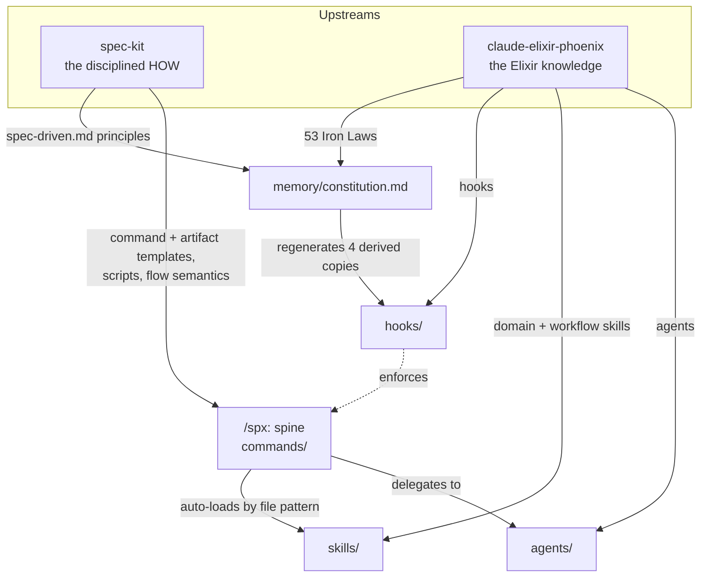

# Architecture

This document explains how `claude-speckit-phx-elixir` is built, for contributors who want
to understand or extend it. For the user-facing tour, start with the
[README](../README.md). For the exhaustive build record, see `BLUEPRINT.md` at the repo root —
this document distills it.

## The core idea: a spine and its intelligence

The plugin is a **fusion**, not a bundle. It takes one thing from each upstream and welds
them together:

- From **spec-kit**, the *spine*: the linear, disciplined spec-driven flow where
  specifications are the source of truth and every phase stops before the next. This spine is
  stack-agnostic and works in any repository.
- From **claude-elixir-phoenix**, the *intelligence*: 26 specialist agents, the Elixir/Phoenix
  domain skills, the enforcement hooks, and the 53 Iron Laws.

The fusion principle is that intelligence is absorbed *into* the spine rather than run
alongside it. `/spx:plan` is not "spec-kit plan, then separately consult Elixir advice"; it is
a single command whose planning body delegates to `ecto-schema-designer`, `liveview-architect`,
and the others, and whose output template carries an Elixir/Phoenix Design section. Nothing
essential from either upstream was dropped silently — every absorbed or dropped asset is
recorded with a reason in `BLUEPRINT.md` section 4 (the Absorption Map).



## Directory map

```text
claude-speckit-phx-elixir/
├── .claude-plugin/
│   ├── plugin.json          # manifest (name, version, description, keywords)
│   └── marketplace.json     # single-plugin marketplace, source "./"
├── memory/
│   ├── constitution.md      # THE canonical 53-law corpus (8 Articles)
│   └── derivations.md        # single-source rule + the 4 derived copies
├── templates/                # 9 templates: constitution, spec, plan, tasks, checklist,
│                             #   claude-md-block, agents-md-block, extensions.yml, git-config.yml
├── scripts/                  # 6 bash scripts + scripts/git/ (3 more); all self-gate, --json
├── commands/                 # 21 spec-kit-derived lifecycle command files
├── agents/                   # 26 flat specialist subagents
├── skills/                   # 48 skill dirs (domain/infra auto-load + workflow commands)
└── hooks/
    ├── hooks.json            # event wiring
    ├── scripts/              # 23 hook scripts
    └── tests/                # shipped regression harness
```

The 55 user-facing commands are split by mechanism: the 21 lifecycle commands live in
`commands/` as command files; the 34 capability commands live in `skills/` as invocable
skills. Skills are used for the capability layer because a skill can ship `references/`,
`scripts/`, and `priv/` alongside its body, which command files cannot — several capability
commands (deps-audit, watch-pr, mix-compression) need those bundled assets.

## The constitution and its four enforcement channels

The constitution is single-sourced. `memory/constitution.md` is the *only* canonical corpus,
with unified law numbering. From it, four derived copies are regenerated whenever it changes —
this regeneration is a mandatory step inside `/spx:constitution`, and the rule is recorded in
`memory/derivations.md`:

1. **The CLAUDE.md marker block** — a condensed constitution installed into the project's
   `CLAUDE.md`, refreshed by `/spx:agent-context`.
2. **SubagentStart injection** (`hooks/scripts/inject-iron-laws.sh`) — subagents load zero
   skills, so the laws reach them only through this hook, which injects the full Article II
   corpus at spawn time.
3. **The PostToolUse verifier** (`hooks/scripts/iron-law-verifier.sh`) — a programmatic check
   of the mechanically-detectable laws (4, 10, 12, 14, 15, 21) on every edit.
4. **The codex review rubric** in the AGENTS.md managed block — the P1-P3 severity rubric used
   by the codex-loop and review paths.

Keeping these four in sync is Article VII of the constitution itself. A contributor editing a
law must never hand-edit the derived copies; they are outputs, regenerated from the source.

## How a phase runs

Each spine command is a self-contained procedure. It carries the spec-kit Pre/Post hook
semantics inline as ordered steps (for example, git-init runs before constitution; git-feature
before specify; agent-context after specify and plan). Scripts are invoked through
`${CLAUDE_PLUGIN_ROOT}/scripts/`. A typical phase:

1. Calls a bash script to establish prerequisites and paths (`check-prerequisites.sh`,
   `setup-plan.sh`, etc.). Every script self-gates and can emit `--json`.
2. Detects the stack (grepping `mix.exs` for Phoenix, Ecto, Oban, Oban Pro, Ash, Tidewave) and
   activates the relevant conditional annexes.
3. Loads matching skills silently by file pattern (`*_live.ex` pulls in `liveview-patterns`,
   `*_worker.ex` pulls in `oban`, migrations and schemas pull in `ecto-patterns`).
4. Spawns specialist agents when triggered, fanning out in one message, running them in the
   background, waiting for all, and compressing four-plus outputs through
   `context-supervisor`. Agent output goes to files under `specs/<feature>/`, never raw into
   chat (Workflow Law W17).
5. Writes its artifact and stops, presenting the next step. Nothing auto-transitions except
   `/spx:full`, which obeys its own cycle caps.

## Elixir gating

The spine must be safe in any repository. Every Elixir-specific hook and behavior self-gates
on the presence of `mix.exs`, so on a non-Elixir project the spec-driven flow still works and
the Elixir intelligence simply stays dormant. The one global exception is the dangerous-git
protection, which applies everywhere. This is why the plugin can be installed globally without
imposing Elixir assumptions on unrelated projects.

## Model economics

Agents are assigned models by cost sensitivity: `haiku` for the cheap, high-volume roles
(context supervision, verification running, web research, codex review, xref analysis);
`opus` only where deep reasoning pays off (the parallel reviewer, the security analyzer, the
full-driver); `sonnet` everywhere else. Subagent nesting is capped at depth 5. Read-only
reviewers run with `omitClaudeMd` so they are not biased by project instructions.

## Key design decisions

These are the cross-cutting decisions a contributor should know before making changes. The
full set (D1-D13) is in `BLUEPRINT.md`.

| Decision | Summary |
|---|---|
| Namespace | Every command is `/spx:*`; the Claude command separator is hard-coded as `-`. |
| Artifact layout | The feature workspace is `specs/<NNN-slug>/`; cross-feature state is under `.specify/` and `.claude/`. Anything that once hardcoded `.claude/plans/` was re-pointed to `specs/<feature>/`. |
| Constitution single-sourcing | One canonical corpus; four derived copies regenerated on amendment. |
| full vs flow | spec-kit's workflow engine and the phx `/phx:full` fuse into one `/spx:full` driven by the `full-driver` agent — never a parallel mini-flow. |
| Attribution | `NOTICE.md` carries the MIT notices for both upstreams; both are credited in the README. |
| Quotes | Straight quotes only, everywhere, including generated UI strings and flashes. |

## Extending the plugin

- **Add or change an Iron Law** — edit `memory/constitution.md`, then regenerate the four
  derived copies (this is what `/spx:constitution` does; do it the same way, do not hand-edit
  the copies). Bump the constitution semver and add a Sync Impact Report.
- **Add a specialist agent** — drop a flat `*.md` into `agents/`, assign it a model per the
  economics above, and wire it into the phase that should delegate to it. Its output must land
  in a file under the feature's declared output dir.
- **Add a capability command** — create a skill directory under `skills/` with
  `name: spx:<cmd>` frontmatter; bundle any `references/` or `scripts/` it needs.
- **Add a hook** — add the script under `hooks/scripts/`, wire the event in `hooks/hooks.json`,
  and self-gate on `mix.exs` if it is Elixir-specific. Respect each event's output contract
  (for example, PostToolUse uses exit 2 plus stderr; UserPromptSubmit must never exit 2).
- **Change a template** — templates in `templates/` are consumed by the spine commands at run
  time; keep the Elixir/Phoenix fusion blocks intact when editing the plan and tasks templates.

Before opening a pull request, run the markdown lint (`.markdownlint.json`) and, if you touched
hooks, the shipped regression harness under `hooks/tests/`. See [CONTRIBUTING.md](../CONTRIBUTING.md).
