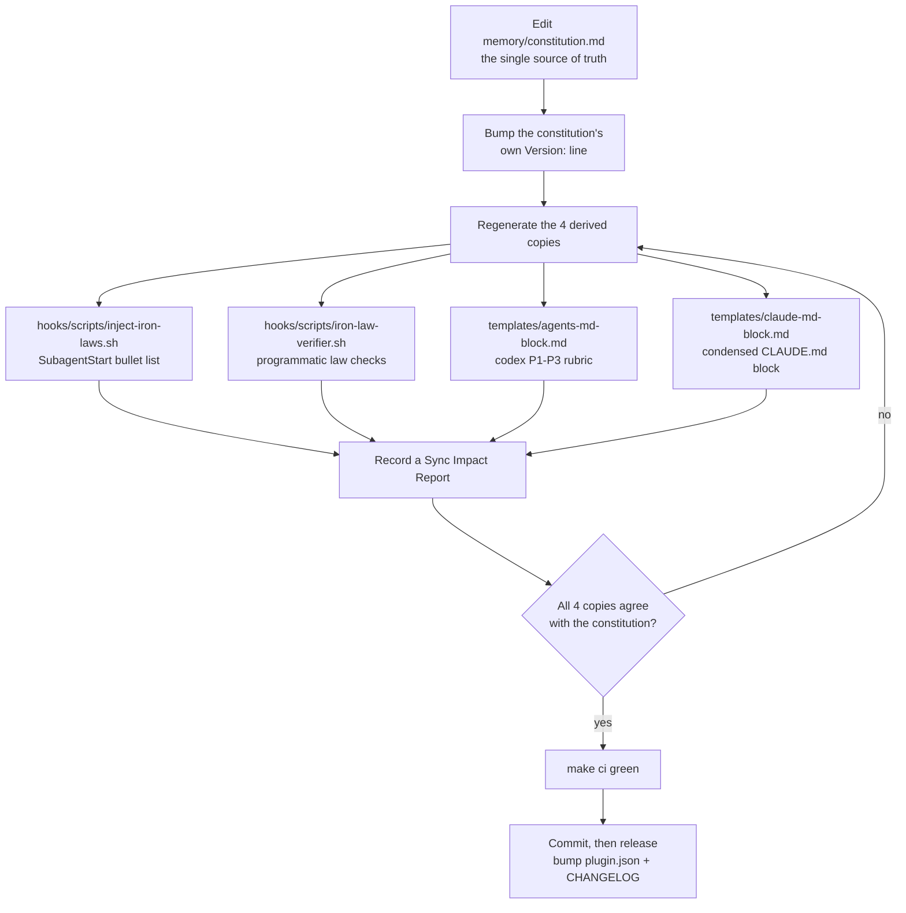

# Release Process

How we cut a release of **claude-speckit-phx-elixir**. This is a Claude Code
plugin (a set of commands, agents, skills, hooks, scripts, and templates), not a
compiled artifact — a "release" is a git tag plus a GitHub Release that users can
install from the marketplace. There is no package to publish to a registry.

<!-- markdownlint-disable MD024 -->

## Table of contents

- [Versioning (SemVer)](#versioning-semver)
- [The single source of version truth](#the-single-source-of-version-truth)
- [Before you tag](#before-you-tag)
- [Cutting a release](#cutting-a-release)
- [The constitution amendment ritual](#the-constitution-amendment-ritual)
- [CHANGELOG conventions](#changelog-conventions)
- [Checklist](#checklist)

## Versioning (SemVer)

Versions follow [Semantic Versioning](https://semver.org/): `MAJOR.MINOR.PATCH`,
starting from `0.1.0`. Because a plugin's public surface is what users type and
rely on, we version against that surface:

| Bump      | When                                                                                                       | Examples |
|-----------|------------------------------------------------------------------------------------------------------------|----------|
| **MAJOR** | A breaking change to the user-facing contract.                                                             | Renaming or removing a `/spx:*` command; renaming a skill or agent; removing a hook event; a constitution change that flips a NON-NEGOTIABLE principle or renumbers Iron Laws in a way projects depend on. |
| **MINOR** | New capability, backward compatible.                                                                       | A new `/spx:*` command, agent, skill, or hook; a new template; a new opt-in flag; additive Iron Laws. |
| **PATCH** | Fixes and internal changes with no contract change.                                                        | Fixing a hook regex; wording/typo fixes; doc updates; refactoring a script; tightening a check. |

Pre-1.0 caveat: while the version is `0.y.z`, the API is still stabilising, so a
`MINOR` bump may carry small breaking changes when unavoidable — call these out
loudly in the CHANGELOG. After `1.0.0`, MAJOR is reserved strictly for breaks.

Tags MUST be `vMAJOR.MINOR.PATCH` (e.g. `v0.1.0`, `v0.2.0`, `v1.0.0`).

## The single source of version truth

`.claude-plugin/plugin.json` `"version"` is authoritative. The git tag MUST match
it exactly (tag `v0.2.0` ⇔ `"version": "0.2.0"`). The `make ci` gate and the
`Validate` workflow both assert the version is well-formed; keeping the tag in
sync with the manifest is a release-time responsibility.

Note the plugin's **own** version is distinct from a **project's constitution
version**. The shipped default `memory/constitution.md` carries its own SemVer
line (`Version: X.Y.Z`) which tracks the Iron-Law corpus, and each project that
installs the plugin then amends its own copy independently. See
[the ritual](#the-constitution-amendment-ritual).

## Before you tag

Run the full local gate — it mirrors CI:

```bash
make ci    # lint + validate + hook tests
```

This runs, in order:

1. `make lint` — markdownlint, yamllint, JSON parse of every `*.json`,
   `hooks.json`/`plugin.json` shape, and shellcheck on every `*.sh`.
2. `make validate` — `claude plugin validate .` when the CLI is installed,
   otherwise `.github/scripts/structural-checks.sh` (frontmatter on every
   command/agent/skill, manifest keys, hooks.json shape).
3. `make test` — the hook regression suite in `hooks/tests/`.

The same three jobs run on every push and PR via `.github/workflows/lint.yml`
and `.github/workflows/validate.yml`, with `codeql.yml` scanning the shipped
Python helpers and Actions workflows.

## Cutting a release

1. **Land all changes** on `main` (via PR, green CI).
2. **Bump the version** in `.claude-plugin/plugin.json`.
3. **Finalize the CHANGELOG**: rename the `## [Unreleased]` section to
   `## [X.Y.Z] - YYYY-MM-DD`, then add a fresh empty `## [Unreleased]` above it.
   Update the link references at the bottom.
4. **Gate**: `make ci` must be green.
5. **Commit** the bump:

   ```bash
   git commit -am "chore(release): v0.2.0"
   ```

6. **Tag** it, matching the manifest exactly:

   ```bash
   git tag -a v0.2.0 -m "v0.2.0"
   git push origin main --follow-tags
   ```

7. **Create the GitHub Release** from the tag, pasting that version's CHANGELOG
   section as the notes:

   ```bash
   gh release create v0.2.0 --title "v0.2.0" --notes-file <(sed -n '/## \[0.2.0\]/,/## \[/p' CHANGELOG.md)
   ```

   Or open **Releases → Draft a new release** in the GitHub UI, pick the tag,
   and paste the notes by hand.

8. **Announce / verify** the marketplace entry
   (`.claude-plugin/marketplace.json`) still resolves and the plugin installs at
   the new tag.

Never move or re-point an existing tag. If a release is wrong, ship the next
patch — `v0.2.1` — rather than mutating `v0.2.0`.

## The constitution amendment ritual

The plugin's Iron Laws live in exactly one place: `memory/constitution.md`. Four
enforcement copies are **generated** from it and MUST NOT be hand-edited to
change a rule. Any change to the law corpus is therefore a small ritual —
enforced at runtime by `/spx:constitution` (Article VII) and required before any
release that touches the laws.



Steps, in order (also see `memory/derivations.md`):

1. **Edit `memory/constitution.md` only.** Never edit a derived copy by hand to
   change a rule.
2. **Bump the constitution's own `Version:` line** (SemVer, independent of the
   plugin version).
3. **Regenerate the four derived copies** so each mirrors the current laws:
   - `hooks/scripts/inject-iron-laws.sh` — the flat Iron-Law bullet list injected
     into every subagent (subagents load no skills, so this hook is their only
     channel).
   - `hooks/scripts/iron-law-verifier.sh` — the grep/AST checks for the
     programmatically checkable laws; keep law numbers and patterns aligned.
   - `templates/agents-md-block.md` — the codex/AGENTS.md P1–P3 review rubric.
   - `templates/claude-md-block.md` — the condensed marker block installed into a
     project's `CLAUDE.md` (7-step router + law summary).
4. **Record a Sync Impact Report** in the amendment (what changed, which
   principles/laws, which copies were regenerated).
5. **Verify all four copies agree** with the constitution, then run `make ci`.

Because the laws are user-facing, a change that renumbers or removes Iron Laws or
flips a NON-NEGOTIABLE principle is a **MAJOR** plugin bump; purely additive laws
are **MINOR**; wording/clarity fixes are **PATCH**.

## CHANGELOG conventions

`CHANGELOG.md` follows [Keep a Changelog](https://keepachangelog.com/en/1.1.0/).
Keep an `## [Unreleased]` section at the top and move its contents under a dated
version heading at release time. Group entries under the standard headings:
**Added**, **Changed**, **Deprecated**, **Removed**, **Fixed**, **Security**.

```markdown
## [Unreleased]

## [0.2.0] - 2026-08-01

### Added
- `/spx:doctor` health command.

### Fixed
- Force-push detection in `block-dangerous-ops.sh`.
```

## Checklist

- [ ] Changes merged to `main`, CI green.
- [ ] If the laws changed: constitution ritual done, 4 derived copies regenerated,
      Sync Impact Report recorded.
- [ ] `.claude-plugin/plugin.json` version bumped.
- [ ] `CHANGELOG.md` finalized (dated section + fresh `[Unreleased]`).
- [ ] `make ci` green.
- [ ] Commit `chore(release): vX.Y.Z`.
- [ ] Tag `vX.Y.Z` matches the manifest; pushed with `--follow-tags`.
- [ ] GitHub Release created with the CHANGELOG notes.
- [ ] Marketplace install verified at the new tag.
